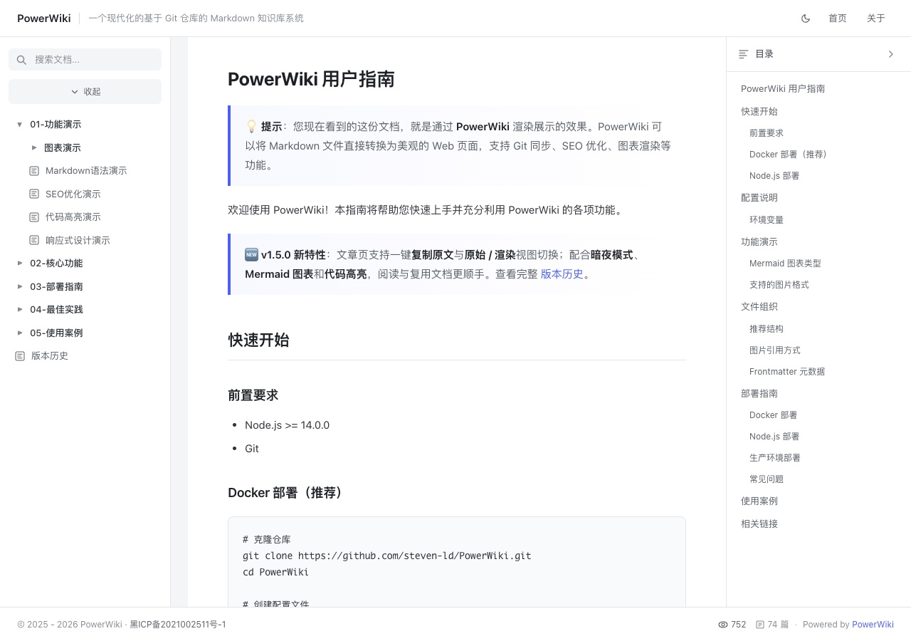
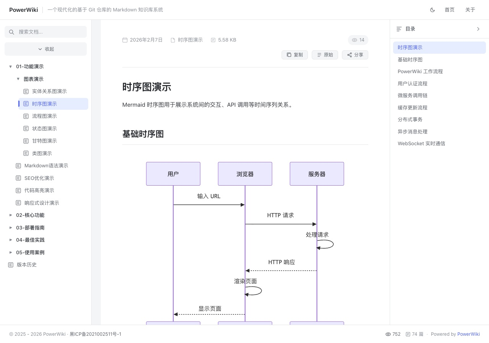
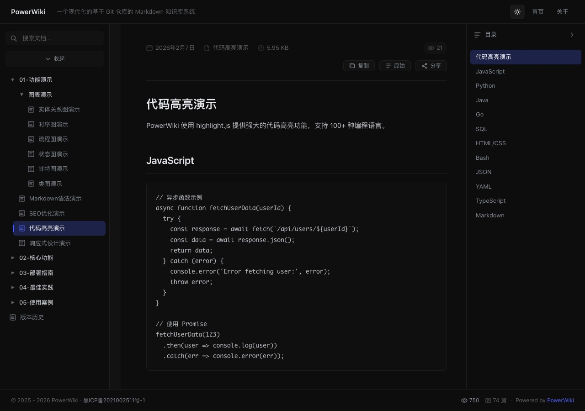

# PowerWiki

<div align="center">


A modern Git-based Markdown wiki system with auto-sync, syntax highlighting, and Feishu-style UI.

**🔗 Live Demo: [https://powerwiki.ga666666.cn](https://powerwiki.ga666666.cn)**

[English](README.md) • [中文](README_ZH.md) • [日本語](docs/README_JA.md) • [한국어](docs/README_KO.md) • [Español](docs/README_ES.md) • [Français](docs/README_FR.md) • [Deutsch](docs/README_DE.md) • [Русский](docs/README_RU.md)

</div>

---

## 📸 See PowerWiki in Action

Screenshots from the [live demo](https://powerwiki.ga666666.cn/). The demo content is in Chinese; your wiki content comes from your own Git repository.

### Your Git documents, ready to browse

Browse nested folders on the left, read Markdown in the center, and jump between headings with the automatic table of contents on the right.



### Read and reuse technical documentation

Code blocks, article metadata, and heading navigation share one reading view. Copy the document, switch to its raw Markdown, or share the article from the toolbar.


### Turn Mermaid text into diagrams

Render sequence diagrams directly inside your articles to explain interactions between users, browsers, and services.



### Switch to dark mode

Use the theme toggle to read the same documentation with a dark background.



---

## 💡 Design Philosophy

PowerWiki was born from deep reflection on "knowledge management" and "technical writing". We believe in:

### 1. Simplicity is Power

No over-engineering, no complex wheels. Markdown + Git is the simplest knowledge management solution proven over a decade. No database, back to file systems, keeping knowledge pure.

### 2. Geeks First

Tailor-made for developers. Syntax highlighting, local image support, Git workflow — every feature comes from real development scenarios.

### 3. Out of the Box

Zero learning cost to get started. Clone and use, push and update. No complex configuration, no dedicated CMS required.

### 4. Persistence & Portability

Your data always belongs to you. Plain text storage, version control built-in, migrate to any platform anytime.

### 5. Privacy & Security

No registration, no cloud. All data stored in an environment you control.

---

## ✨ Features

- **Auto Sync** - Automatically sync from Git repositories
- **Syntax Highlighting** - Code highlighting powered by highlight.js
- **Responsive Design** - Works on all devices
- **Auto TOC** - Automatic table of contents generation
- **Modern UI** - Clean and intuitive interface
- **PDF Support** - Render PDF files as images
- **View Statistics** - Track article views
- **Lightweight** - No database required
- **SEO Optimized** - Full SEO optimization
- **Frontmatter Support** - Parse YAML metadata
- **Local Images** - Support for local images in Markdown
- **Multi-language** - Chinese and English support
- **Docker Ready** - Full Docker support

## 🚀 Quick Start

### Prerequisites

- Node.js >= 14.0.0
- Git

### Option 1: Docker (Recommended)

```bash
# Clone the repository
git clone https://github.com/steven-ld/PowerWiki.git
cd PowerWiki

# Create config file
cp config.example.json config.json
# Edit config.json with your Git repository URL

# Start with Docker Compose
docker-compose up -d
```

### Option 2: Node.js

```bash
# Clone the repository
git clone https://github.com/steven-ld/PowerWiki.git
cd PowerWiki

# Install dependencies
npm install

# Create config file
cp config.example.json config.json
# Edit config.json with your Git repository URL

# Start the server
npm start
```

Visit `http://localhost:3150` in your browser.

## ⚙️ Configuration

Edit `config.json`:

```json
{
  "gitRepo": "https://github.com/your-username/your-wiki-repo.git",
  "repoBranch": "main",
  "port": 3150,
  "siteTitle": "My Wiki",
  "siteDescription": "Knowledge Base",
  "autoSyncInterval": 180000,
  "pages": {
    "home": "README.md",
    "about": "ABOUT.md"
  }
}
```

| Option | Description | Default |
|--------|-------------|---------|
| `gitRepo` | Git repository URL | - |
| `repoBranch` | Branch name | `main` |
| `mdPath` | Markdown files subdirectory | `""` |
| `port` | Server port | `3150` |
| `siteTitle` | Site title | `PowerWiki` |
| `siteDescription` | Site description | `Wiki` |
| `autoSyncInterval` | Auto sync interval (ms) | `180000` |
| `sortOrder` | Sort order (`modified` or `name`) | `modified` |
| `pages.home` | Home page file | `""` |
| `pages.about` | About page file | `""` |

## 🌍 Environment Variables

PowerWiki supports environment variables for flexible deployment:

```bash
# Configuration file path
CONFIG_PATH=/path/to/your/config.json

# Data storage directory (for stats and logs)
DATA_DIR=/path/to/data/directory

# Git repository cache directory
GIT_CACHE_DIR=/path/to/git/cache

# Language setting (zh-CN or en)
LANG=zh-CN
```

Copy `.env.example` to `.env` and customize as needed.

## 🐳 Docker Deployment

### Docker Image

**[@sayunchuan](https://github.com/sayunchuan)** provides a Docker image for PowerWiki.

- **Image**: `sayunchuan/powerwiki`
- **Docker Hub**: [sayunchuan/powerwiki](https://hub.docker.com/r/sayunchuan/powerwiki)
- **Tags**: `latest`, `1.4.5`, `20260207`

### Quick Start

```bash
# Simplest way
docker run -d -p 3150:3150 sayunchuan/powerwiki

# With custom config
docker run -d \
  --name powerwiki \
  -p 3150:3150 \
  -v $(pwd)/config.json:/app/config.json:ro \
  -v powerwiki_data:/app/data \
  -v powerwiki_cache:/app/cache \
  sayunchuan/powerwiki
```

### Docker Compose

```yaml
version: '3.8'
services:
  powerwiki:
    image: sayunchuan/powerwiki:latest
    ports:
      - "3150:3150"
    environment:
      - NODE_ENV=production
      - LANG=zh-CN
    volumes:
      - ./config.json:/app/config.json:ro
      - powerwiki_data:/app/data
      - powerwiki_cache:/app/cache
    restart: unless-stopped

volumes:
  powerwiki_data:
  powerwiki_cache:
```

```bash
# Start services
docker-compose up -d

# View logs
docker-compose logs -f

# Stop services
docker-compose down
```

**Acknowledgment**: Thanks to [@sayunchuan](https://github.com/sayunchuan) for providing the Docker image, making PowerWiki deployment more convenient.

## 📂 Article Organization

PowerWiki supports hierarchical folder structure for organizing articles:

```
your-wiki-repo/
├── README.md              # Home page
├── ABOUT.md               # About page
├── images/                # Global images (optional)
├── Architecture/          # Category folder
│   ├── images/            # Category images
│   ├── IoT-Device-Standards.md
│   ├── TLS-Encryption.md
│   └── README.md          # Category index
├── Projects/              # Another category
│   ├── images/
│   ├── URL-Shortener.md
│   └── README.md
└── Media/
    ├── images/
    ├── WebRTC-Signaling.md
    └── README.md
```

### Article Frontmatter

Each article can include YAML frontmatter for metadata:

```yaml
---
title: Article Title
description: Article description for SEO
author: Author Name
date: 2026-01-10
updated: 2026-01-10
keywords: keyword1, keyword2, keyword3
tags: [tag1, tag2]
---
```

### Image References

PowerWiki supports referencing local images using relative paths in Markdown. The system automatically converts image paths to accessible API URLs:

```markdown
# Method 1: Using images folder in current directory (recommended)


# Method 2: Using parent directory's images folder


# Method 3: Using absolute path (relative to repo root)


# Method 4: Direct reference (without ./ or ../ prefix)

```

Supported image formats: `PNG`, `JPG/JPEG`, `GIF`, `WEBP`, `SVG`, `ICO`

## 🌐 Multi-language Support

PowerWiki supports multiple languages for console output and allows users to customize language packs.

### Supported Languages
- **Chinese Simplified** (`zh-CN`) - Default
- **English** (`en`)

### Usage

```bash
# Start with English
LANG=en npm start

# Start with Chinese
LANG=zh-CN npm start

# Or use npm scripts
npm run start:en
npm run start:zh
```

### Custom Language Packs

PowerWiki uses JSON files for translations and supports adding custom languages.

#### 1. Create Language File

Create a new language file in the `locales/` directory with the format `<language-code>.json`:

```bash
# Example: Create Japanese language file
cp locales/en.json locales/ja.json
```

#### 2. Edit Language File

Modify `locales/ja.json` and replace English translations with Japanese:

```json
{
  "siteTitle": "PowerWiki",
  "siteDescription": "Wiki システム",
  "nav": {
    "home": "ホーム",
    "about": "概要"
  },
  "content": {
    "readingTime": "読み取り時間",
    "words": "語",
    "toc": "目次"
  },
  "actions": {
    "copy": "コピー",
    "copied": "コピー完了"
  },
  "stats": {
    "views": "閲覧数"
  },
  "footer": {
    "poweredBy": "Powered by"
  }
}
```

#### 3. Update Console Language Options

Modify `src/config/i18n.js` and add your new language to the `SUPPORTED_LANGUAGES` array:

```javascript
const SUPPORTED_LANGUAGES = [
  { code: 'zh-CN', name: '中文', file: 'zh-CN.json' },
  { code: 'en', name: 'English', file: 'en.json' },
  { code: 'ja', name: '日本語', file: 'ja.json' },  // Add Japanese
];
```

#### 4. Use Custom Language

```bash
# Start with Japanese
LANG=ja npm start
```

#### Language File Structure Reference

Language files support the following keys (all are optional, missing keys will fall back to English):

| Category | Key | Description |
|----------|-----|-------------|
| Site | `siteTitle` | Website title |
| Site | `siteDescription` | Website description |
| Nav | `nav.home` | Home link text |
| Nav | `nav.about` | About page link text |
| Content | `content.readingTime` | Reading time label |
| Content | `content.words` | Words unit |
| Content | `content.toc` | Table of contents title |
| Actions | `actions.copy` | Copy button |
| Actions | `actions.copied` | Copied success message |
| Stats | `stats.views` | View count label |
| Footer | `footer.poweredBy` | Powered by text |

## 🛠️ Development

### Available Scripts

```bash
# Development
npm run dev              # Start with nodemon
npm run test:env         # Test environment variables

# Docker
npm run docker:build     # Build Docker image
npm run docker:run       # Run Docker container
npm run docker:stop      # Stop and remove container
npm run docker:logs      # View container logs

# Language variants
npm run start:en         # Start with English
npm run start:zh         # Start with Chinese
```

### Project Structure

```
PowerWiki/
├── src/                     # Source code
│   ├── index.js             # Express server entry
│   ├── routes/              # Route modules
│   │   ├── api.js           # API routes
│   │   ├── feeds.js         # RSS/Sitemap routes
│   │   └── static.js        # Static file routes
│   ├── config/              # Configuration
│   │   ├── env.js           # Environment variables
│   │   └── i18n.js          # Internationalization
│   └── utils/               # Utility modules
│       ├── cacheManager.js  # Cache management
│       ├── gitManager.js    # Git operations
│       └── markdownParser.js# Markdown parser
├── locales/                 # Translation files
│   ├── zh-CN.json           # Chinese translations
│   └── en.json              # English translations
├── templates/               # HTML templates
│   ├── header.html          # Header template
│   ├── footer.html          # Footer template
│   └── home.html            # Home template
├── public/                  # Static assets
│   ├── index.html           # Frontend HTML
│   ├── app.js               # Main entry (modular)
│   ├── js/                  # JavaScript modules
│   │   ├── theme.js         # Theme management
│   │   ├── i18n.js         # Internationalization
│   │   ├── cache.js         # Client caching
│   │   ├── utils.js         # Utilities
│   │   ├── posts.js         # Post list & tree
│   │   ├── article.js       # Article rendering
│   │   ├── toc.js           # Table of contents
│   │   └── media.js         # Code copy, images, PDF
│   └── css/                 # CSS modules
│       ├── base.css         # Base styles & variables
│       ├── layout.css       # Layout (sidebar, header)
│       ├── sidebar.css      # Navigation menu
│       ├── article.css      # Article & Markdown
│       ├── toc.css          # Table of contents
│       ├── media.css        # Responsive design
│       └── components.css   # UI components
├── config.example.json      # Config template
├── package.json             # Dependencies
├── Dockerfile               # Docker configuration
└── docker-compose.yml       # Docker Compose
```

## 🛠️ Tech Stack

- **Backend**: Express.js
- **Frontend**: Vanilla JavaScript
- **Git**: simple-git
- **Markdown**: marked + highlight.js
- **PDF**: pdfjs-dist
- **Containerization**: Docker

## 📄 License

MIT License - see [LICENSE](LICENSE) for details.

## 👥 Contributors

- [@sayunchuan](https://github.com/sayunchuan) - Add multi-language, Mermaid support, fix various issues

## 🙏 Credits

- [Express.js](https://expressjs.com/)
- [marked](https://marked.js.org/)
- [highlight.js](https://highlightjs.org/)
- [simple-git](https://github.com/steveukx/git-js)
- [PDF.js](https://mozilla.github.io/pdf.js/)

---

<div align="center">

**If this project helps you, please give it a ⭐ Star!**

</div>
