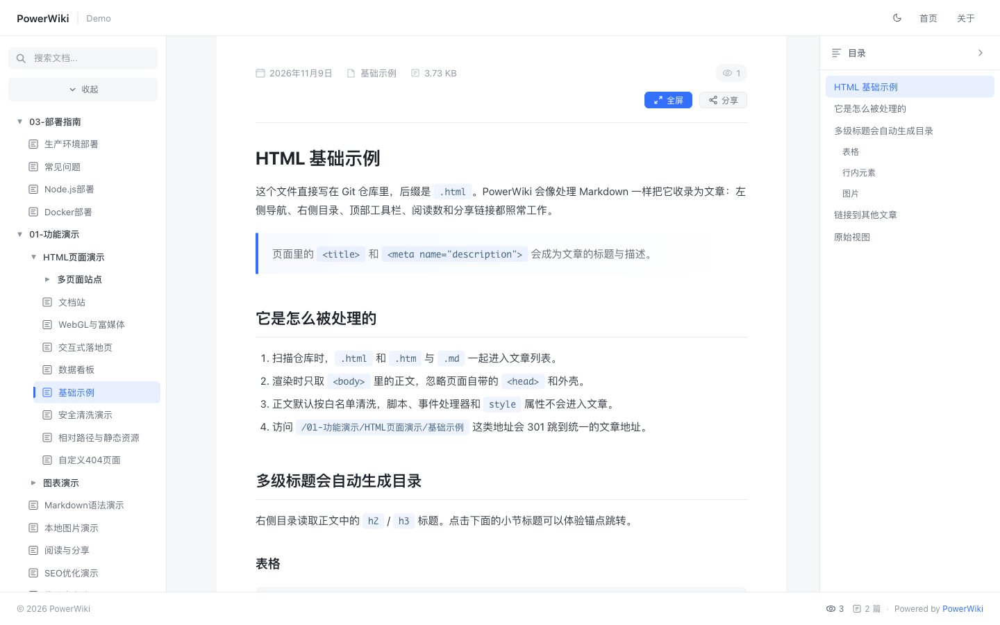
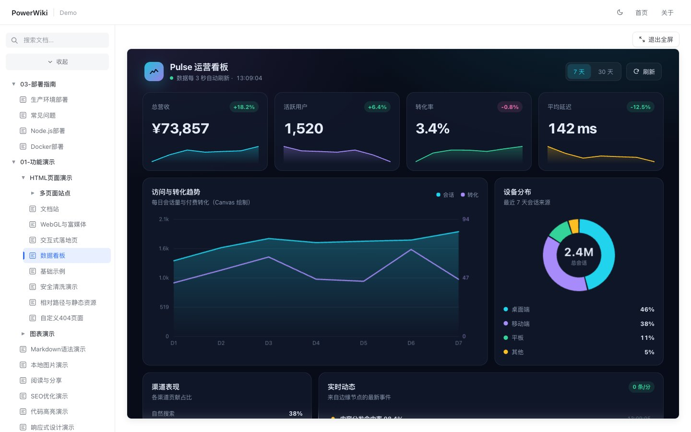

# PowerWiki Dokumentation

<div align="center">


Ein modernes Git-basiertes Markdown-Wiki-System mit automatischer Synchronisierung, Syntax-Highlighting und Feishu-UI.

**🔗 Live-Demo: [https://powerwiki.ga666666.cn](https://powerwiki.ga666666.cn)**

[English](README.md) • [中文](README_ZH.md) • [日本語](docs/README_JA.md) • [한국어](docs/README_KO.md) • [Español](docs/README_ES.md) • [Français](docs/README_FR.md) • [Deutsch](README_DE.md) • [Русский](docs/README_RU.md)

</div>

---

## Sprachauswahl

Dokumentation in anderen Sprachen：

- [English](README.md)
- [中文](README_ZH.md)
- [日本語](README_JA.md)
- [한국어](README_KO.md)
- [Español](README_ES.md)
- [Français](README_FR.md)
- [Deutsch](README_DE.md)
- [Русский](README_RU.md)

## Funktionen

- **Automatische Synchronisierung** - Dokumente automatisch von Git-Repositories abrufen und aktualisieren
- **Syntax-Highlighting** - Syntax-Highlighting für mehrere Programmiersprachen
- **Responsives Design** - Perfekt an alle Bildschirmgrößen angepasst
- **Automatisches Inhaltsverzeichnis** - Inhaltsverzeichnis automatisch generieren
- **Moderne UI** - Sauberes und intuitives Interface-Design
- **PDF-Unterstützung** - PDF-Dateien in hoher Auflösung rendern
- **Besucherstatistiken** - Automatische Statistik der Artikelaufrufe
- **Leichtgewichtig** - Keine Datenbank erforderlich
- **SEO Optimiert** - Suchmaschinensichtbarkeit vollständig optimiert
- **Frontmatter-Unterstützung** - YAML-Metadaten parsen
- **Lokale Bilder** - Unterstützung für lokale Bilder in Markdown
- **HTML-Artikel** - HTML-Dateien aus dem Repository als Artikel, mit Sandbox-Modus für vollständige interaktive Seiten
- **Mehrsprachig** - Unterstützung für Deutsch und Englisch
- **Docker-Unterstützung** - Vollständige Docker-Deployment-Unterstützung

## Schnellstart

### Voraussetzungen

- Node.js >= 14.0.0
- Git

### Docker verwenden (Empfohlen)

```bash
# Repository klonen
git clone https://github.com/steven-ld/PowerWiki.git
cd PowerWiki

# Konfigurationsdatei erstellen
cp config.example.json config.json
# config.json mit Ihrer Git-Repository-URL bearbeiten

# Mit Docker Compose starten
docker-compose up -d
```

### Node.js verwenden

```bash
# Repository klonen
git clone https://github.com/steven-ld/PowerWiki.git
cd PowerWiki

# Abhängigkeiten installieren
npm install

# Konfigurationsdatei erstellen
cp config.example.json config.json
# config.json mit Ihrer Git-Repository-URL bearbeiten

# Server starten
npm start
```

Besuchen Sie `http://localhost:3150` in Ihrem Browser.

## Konfiguration

`config.json` bearbeiten：

```json
{
  "gitRepo": "https://github.com/your-username/your-wiki-repo.git",
  "repoBranch": "main",
  "port": 3150,
  "siteTitle": "My Wiki",
  "siteDescription": "Knowledge Base",
  "autoSyncInterval": 180000,
  "html": {
    "enabled": true,
    "sanitize": true
  },
  "pages": {
    "home": "README.md",
    "about": "ABOUT.md",
    "notFound": "404.html"
  }
}
```

| Option | Beschreibung | Standard |
|--------|--------------|----------|
| `gitRepo` | Git-Repository-URL | - |
| `repoBranch` | Branch-Name | `main` |
| `mdPath` | Markdown-Dateien Unterverzeichnis | `""` |
| `port` | Server-Port | `3150` |
| `siteTitle` | Seitentitel | `PowerWiki` |
| `siteDescription` | Seitenbeschreibung | `Wiki` |
| `autoSyncInterval` | Auto-Sync-Intervall (ms) | `180000` |
| `sortOrder` | Sortierreihenfolge (`modified` oder `name`) | `modified` |
| `pages.home` | Startseitendatei | `""` |
| `pages.about` | Über-Seitendatei | `""` |
| `pages.notFound` | Eigene 404-Seite (`.html` oder `.md`) | integrierte Seite |
| `html.enabled` | HTML-Dateien als Artikel aufnehmen | `true` |
| `html.sanitize` | Artikelkörper nach Allowlist bereinigen | `true` |

## Docker-Deployment

### Docker-Image

**[@sayunchuan](https://github.com/sayunchuan)** stellt ein Docker-Image für PowerWiki bereit.

- **Image**: `sayunchuan/powerwiki`
- **Docker Hub**: [sayunchuan/powerwiki](https://hub.docker.com/r/sayunchuan/powerwiki)
- **Tags**: `latest`, `1.4.5`, `20260207`

### Schnellstart

```bash
# Einfachste Methode
docker run -d -p 3150:3150 sayunchuan/powerwiki

# Mit benutzerdefinierter Konfiguration
docker run -d \
  --name powerwiki \
  -p 3150:3150 \
  -v $(pwd)/config.json:/app/config.json:ro \
  -v powerwiki_data:/app/data \
  -v powerwiki_cache:/app/cache \
  sayunchuan/powerwiki
```

### Deployment mit Docker Compose

```yaml
version: '3.8'
services:
  powerwiki:
    image: sayunchuan/powerwiki:latest
    ports:
      - "3150:3150"
    environment:
      - NODE_ENV=production
      - LANG=de
    volumes:
      - ./config.json:/app/config.json:ro
      - powerwiki_data:/app/data
      - powerwiki_cache:/app/cache
    restart: unless-stopped

volumes:
  powerwiki_data:
  powerwiki_cache:
```

```bash
# Dienste starten
docker-compose up -d

# Logs anzeigen
docker-compose logs -f

# Dienste stoppen
docker-compose down
```

**Danksagung**: Vielen Dank an [@sayunchuan](https://github.com/sayunchuan) für die Bereitstellung des Docker-Images, wodurch die Bereitstellung von PowerWiki bequemer wird.

## Artikelorganisation

PowerWiki unterstützt eine hierarchische Ordnerstruktur zur Organisation von Artikeln：

```
your-wiki-repo/
├── README.md              # Startseite
├── ABOUT.md               # Über-Seite
├── images/                # Globale Bilder (optional)
├── Architecture/          # Kategorieordner
│   ├── images/            # Kategoriebilder
│   ├── IoT-Device-Standards.md
│   ├── TLS-Encryption.md
│   └── README.md          # Kategorieindex
└── Projects/              # Eine weitere Kategorie
    ├── images/
    ├── URL-Shortener.md
    └── README.md
```

### Artikel-Frontmatter

Jeder Artikel kann YAML-Frontmatter-Metadaten enthalten：

```yaml
---
title: Artikeltitel
description: Artikelbeschreibung für SEO
author: Autorenname
date: 2026-01-10
updated: 2026-01-10
keywords: schlagwort1, schlagwort2, schlagwort3
tags: [tag1, tag2]
---
```

## HTML-Artikel

HTML-Dateien werden wie Markdown-Artikel behandelt: Sie erscheinen in der Seitenleiste, werden unter `/post/<Repository-Pfad>` ausgeliefert und nutzen dieselbe Leseansicht mit Inhaltsverzeichnis, Kopieren, Rohansicht, Freigabe und SEO. Alte Adressen wie `/docs/page` oder `/docs/page.html` leiten mit 301 auf `/post/docs/page.html` um. Gerendert wird nur der `<body>`; `<title>` und `<meta name="description|keywords">` liefern die Artikelmetadaten. Auch `pages.home` darf auf eine `.html`-Datei zeigen.



Der Körper wird standardmäßig bereinigt: `<script>`, `<style>`, `<iframe>`, Formulare, Inline-Event-Handler und `style`-Attribute entfallen, `javascript:`-URLs werden verworfen. Relative Adressen werden serverseitig umgeschrieben: Bilder auf `/api/image/...`, Links auf andere HTML-/Markdown-/PDF-Dateien auf `/post/...`, übrige Assets relativ zum Verzeichnis der Seite. `html.sanitize: false` nur für vollständig vertrauenswürdige Inhalte setzen.

### Vollständige HTML-Seiten (Sandbox)

Interaktive Seiten aktivieren den Sandbox-Modus im `<head>`:

```html
<meta name="powerwiki-render" content="sandbox">
```

Dann wird die Seite unbereinigt in einem `iframe` eingebettet: Skripte, Formulare, Popups, Downloads und nutzergesteuerte Top-Navigation sind erlaubt, `allow-same-origin` nicht. Die Seite läuft in einer undurchsichtigen Origin und kann weder Cookies, localStorage noch Same-Origin-APIs des Wikis lesen. Die Originalseite ist zusätzlich unter `/full/<Repository-Pfad>` mit `Content-Security-Policy: sandbox ...` erreichbar; diese Route liefert nur HTML und statische Assets und lehnt Traversal, versteckte Pfadsegmente, Symlinks und Dateien über 50 MB ab.



### Immersives Lesen

Sandbox-Seiten und HTML-Startseiten öffnen direkt immersiv: Die Lesefläche füllt das Viewport, `Esc` oder die Schaltfläche oben rechts kehrt zurück, das `iframe` wird nicht neu geladen. Der Server liefert den immersiven Zustand bereits im ersten Frame, daher gibt es beim Laden keinen Breitensprung. Die Höhe folgt dem gemeldeten Inhalt (240–20000px), sodass außerhalb des immersiven Modus keine zweite Scrollleiste entsteht. Normale HTML-Artikel ohne Sandbox-Meta haben kein `iframe`, scrollen als normale Seite und öffnen ihre **Vollbild**-Schaltfläche unter `/full/...` in einem neuen Tab.

Der Artikelrahmen sendet Sandbox-Seiten beim Laden und bei jedem Themenwechsel `{ type: 'powerwiki:context', version: 1, theme, lang }`; eine Seite kann ihn mit `parent.postMessage({ type: 'powerwiki:request-context' }, '*')` anfordern.

## Technologie-Stack

- **Backend**: Express.js
- **Frontend**: Vanilla JavaScript
- **Git**: simple-git
- **Markdown**: marked + highlight.js
- **PDF**: pdfjs-dist
- **Containerisierung**: Docker

## Projektstruktur

```
PowerWiki/
├── src/                     # Quellcode
│   ├── index.js             # Einstiegspunkt des Express-Servers
│   ├── routes/              # Routen-Module
│   │   ├── api.js           # API-Routen
│   │   ├── feeds.js         # RSS/Sitemap-Routen
│   │   └── static.js        # Statische Datei-Routen
│   ├── config/              # Konfigurations-Module
│   │   ├── env.js           # Umgebungsvariablen
│   │   └── i18n.js          # Internationalisierung
│   └── utils/               # Hilfsmodule
│       ├── cacheManager.js  # Cache-Verwaltung
│       ├── gitManager.js    # Git-Operationen
│       └── markdownParser.js# Markdown-Parser
├── locales/                 # Übersetzungsdateien
├── templates/               # HTML-Vorlagen
├── public/                  # Statische Assets
│   ├── index.html          # Frontend HTML
│   ├── app.js             # Haupteinstieg (modular)
│   ├── js/                # JavaScript-Module
│   │   ├── theme.js       # Theme-Verwaltung
│   │   ├── i18n.js        # Internationalisierung
│   │   ├── cache.js       # Client-Caching
│   │   ├── utils.js       # Hilfsfunktionen
│   │   ├── posts.js       # Beitragsliste & Baum
│   │   ├── article.js     # Artikel-Rendering
│   │   ├── toc.js         # Inhaltsverzeichnis
│   │   └── media.js       # Code-Kopieren, Bilder, PDF
│   └── css/               # CSS-Module
│       ├── base.css       # Basis-Stile & Variablen
│       ├── layout.css     # Layout
│       ├── sidebar.css    # Navigationsmenü
│       ├── article.css    # Artikel & Markdown
│       ├── toc.css        # Rechtes Inhaltsverzeichnis
│       ├── media.css      # Responsive Design
│       └── components.css # UI-Komponenten
├── config.example.json      # Konfigurationsvorlage
└── package.json             # Abhängigkeiten
```

## Lizenz

MIT License - see [LICENSE](LICENSE) für Details.

## Mitwirkende

- [@sayunchuan](https://github.com/sayunchuan) - Mehrsprachige Unterstützung, Mermaid-Unterstützung hinzugefügt, verschiedene Probleme behoben

---

<div align="center">

**Wenn dieses Projekt hilft, bitte ⭐ Stern geben!**

</div>
